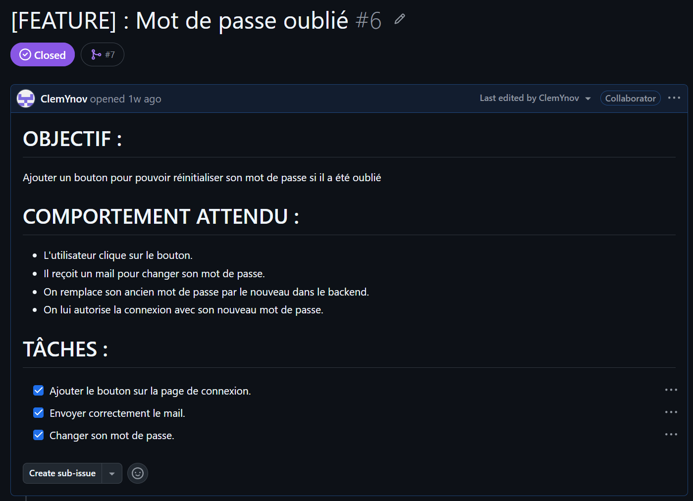
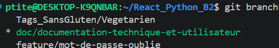
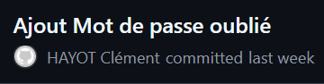
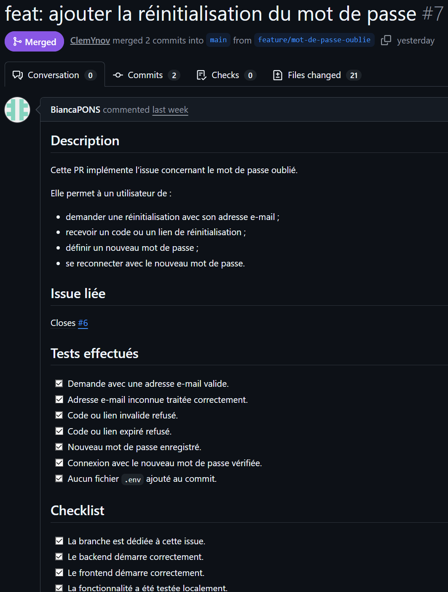
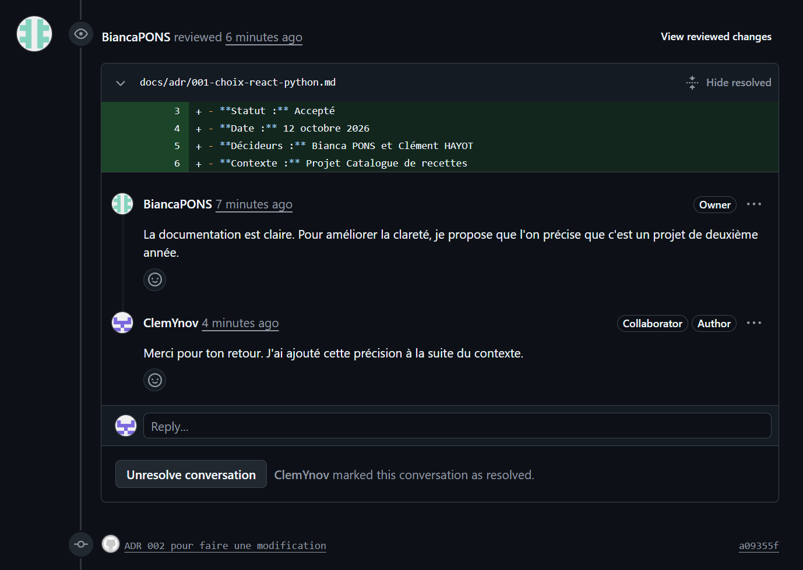
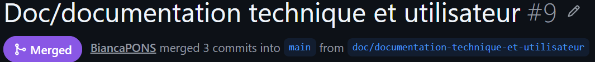
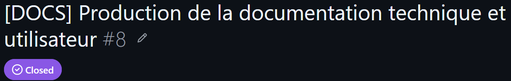

# Compte rendu — Travail collaboratif et documentation technique

## Informations générales

| Élément | Information |
|---|---|
| Projet | Catalogue de recettes |
| Matière | Travail Collaboratif & Documentation Technique |
| Formateur | Reype Costa |
| Membres du groupe | Bianca PONS / Clément HAYOT |
| Dépôt GitHub | [https://github.com/BiancaPONS/React_Python_B2] |
| Date de rendu | [12/10/2026] |

## Objectif du travail

L'objectif de ce travail était de mettre en œuvre un workflow Git collaboratif complet et de produire une documentation technique permettant à une autre personne de comprendre, installer, utiliser et faire évoluer le projet.

Le projet concerné est une application web nommée **Catalogue de recettes**. Elle est composée :

- d'un frontend React avec TypeScript et Vite ;
- d'une API FastAPI ;
- d'une base PostgreSQL exécutée avec Docker Compose ;
- d'une authentification par JWT et code envoyé par email ;
- d'une fonctionnalité de réinitialisation de mot de passe.

## Présentation rapide du projet

```text
Navigateur
    ↓
Frontend React / Vite
    ↓ HTTP
API FastAPI
    ↓
PostgreSQL
```

Le frontend est accessible sur :

```text
http://localhost:5173
```

L'API est accessible sur :

```text
http://localhost:8000
```

La documentation Swagger est accessible sur :

```text
http://localhost:8000/docs
```

---

# 1. Workflow Git

## 1.1 Création de l'issue

Nous avons créé une issue GitHub afin de formaliser le besoin fonctionnel avant de modifier le code.

### Issue concernée

| Élément | Information |
|---|---|
| Numéro | #6 |
| Titre | [[FEATURE] : Mot de passe oublié] |
| Objectif | [Créer un système de réinitialisation du mot de passe] |
| Labels | [FEATURE] |
| Assigné(e) | [ClemYnov] |

### Contenu de l'issue

L'issue présentait :

- le contexte ;
- le besoin fonctionnel ;
- les critères d'acceptation ;
- les éléments techniques concernés ;
- les tests attendus.

> **Capture 1 — Issue GitHub créée**
>
> 

## 1.2 Création de la branche

Nous avons créé une branche dédiée à partir de `main`, sans modifier directement la branche principale.

| Élément | Information |
|---|---|
| Branche principale | `main` |
| Branche de travail | `[feature/mot-de-passe-oublie]` |
| Convention utilisée | `[exemple : feature/issue-description]` |

Exemple de commande utilisée :

```bash
git checkout main
git pull origin main
git checkout -b [feature/mot-de-passe-oublie]
```

> **Capture 2 — Branche de travail**
>
> 

## 1.3 Réalisation des commits

Nous avons réalisé des commits sur notre branche de travail.

| Commit | Description |
|---|---|
| `[eb1cc72]` | `Ajout mot de passe oublié` |

Le message de commit décrit clairement les modifications réalisées.

> **Capture 3 — Historique des commits**
> 

## 1.4 Création de la Pull Request

Une Pull Request a été créée pour proposer l'intégration de la branche de travail dans `main`.

| Élément | Information |
|---|---|
| Numéro de PR | #7 |
| Titre | [feat: ajouter la réinitialisation du mot de passe] |
| Branche source | `[feature/mot-de-passe-oublie]` |
| Branche cible | `main` |

La Pull Request contient :

- une description du travail réalisé ;
- une checklist de vérification ;
- un lien vers l'issue concernée ;
- les tests réalisés ;
- les éventuelles limites connues.

> **Capture 4 — Pull Request créée**
>
> 

## 1.5 Code review

La Pull Request a fait l'objet d'une relecture par un membre du groupe.

### Commentaire de review

| Élément | Information |
|---|---|
| Reviewer | [BiancaPONS] |
| Fichier commenté | [] |
| Commentaire | [RÉSUMÉ DU COMMENTAIRE] |
| Correction réalisée | [Modification ADR] |

> **Capture 5 — Commentaire de review**
>
> 


## 1.6 Validation et fusion

Après la review et les corrections éventuelles, la Pull Request a été fusionnée dans `main`.

| Élément | Information |
|---|---|
| État final de la PR | [Merged / Fusionnée] |
| Méthode de fusion | [Merge commit] |

> **Capture 7 — Pull Request fusionnée**
>
> 

## 1.7 Fermeture de l'issue

L'issue a été fermée après la fusion de la Pull Request.

| Élément | Information |
|---|---|
| Numéro de l'issue | #8 |
| État final | Closed / Fermée |
| Méthode | Fermeture automatique via `Closes #8` |

> **Capture 8 — Issue fermée**
>
> 
---

# 2. Documentation technique

## 2.1 README

Nous avons rédigé plusieurs README afin de faciliter l'installation et la prise en main du projet :

| Fichier | Rôle |
|---|---|
| `README.md` | Présentation et démarrage global du projet |
| `api/README.md` | Installation, configuration et lancement du backend |
| `web/README.md` | Installation, configuration et lancement du frontend |

Les README décrivent notamment :

- les prérequis ;
- l'architecture du projet ;
- les variables d'environnement ;
- le démarrage avec Docker, PostgreSQL, FastAPI et Vite ;
- les principales fonctionnalités ;
- les routes API ;
- les problèmes fréquents et leurs solutions.


## 2.2 Architecture Decision Record

Nous avons rédigé l'ADR suivant :

```text
docs/adr/001-choix-react-python.md
docs/adr/002-choix-react-python.md
```

### Décision documentée

L'application utilise :

- bcrypt pour hasher les mots de passe ;
- un code à six chiffres envoyé par email comme seconde étape de connexion ;
- des codes hashés, expirables et à usage unique ;
- un token JWT pour les routes protégées ;
- un flux indépendant de réinitialisation de mot de passe.

### Raisons du choix

Cette solution améliore la sécurité de l'authentification tout en restant adaptée au contexte pédagogique du projet.

L'ADR présente également :

- le contexte ;
- la décision prise ;
- les alternatives étudiées ;
- les avantages ;
- les limites ;
- les conséquences techniques.


## 2.3 Documentation utilisateur

Nous avons produit un guide destiné à un utilisateur non développeur :

```text
docs/utilisateur/GUIDE_UTILISATEUR.md
```

Le guide explique :

- comment consulter les recettes ;
- comment créer un compte ;
- comment se connecter avec le code email ;
- comment réinitialiser un mot de passe ;
- comment ajouter une recette à sa collection ;
- comment modifier le statut, la note ou le commentaire ;
- comment consulter les statistiques ;
- comment résoudre les problèmes les plus fréquents.

---

# 4. Conclusion

Ce travail nous a permis de mettre en pratique un workflow Git collaboratif complet :

```text
Issue
  ↓
Branche dédiée
  ↓
Commits descriptifs
  ↓
Pull Request
  ↓
Code review
  ↓
Corrections
  ↓
Merge dans main
  ↓
Fermeture de l'issue
```

Nous avons également créé une documentation permettant :

- à un développeur d'installer et lancer le projet ;
- de comprendre les choix techniques grâce à l'ADR ;
- à un utilisateur non technique d'utiliser l'application ;
- de faciliter la reprise du projet par une autre équipe.

Les documents fournis avec ce compte rendu sont :

```text
README.md
api/README.md
web/README.md
docs/adr/001-choix-react-python.md
docs/adr/002-choix-react-python.md
docs/utilisateur/GUIDE_UTILISATEUR.md
docs/COMPTE_RENDU_TP.md
```